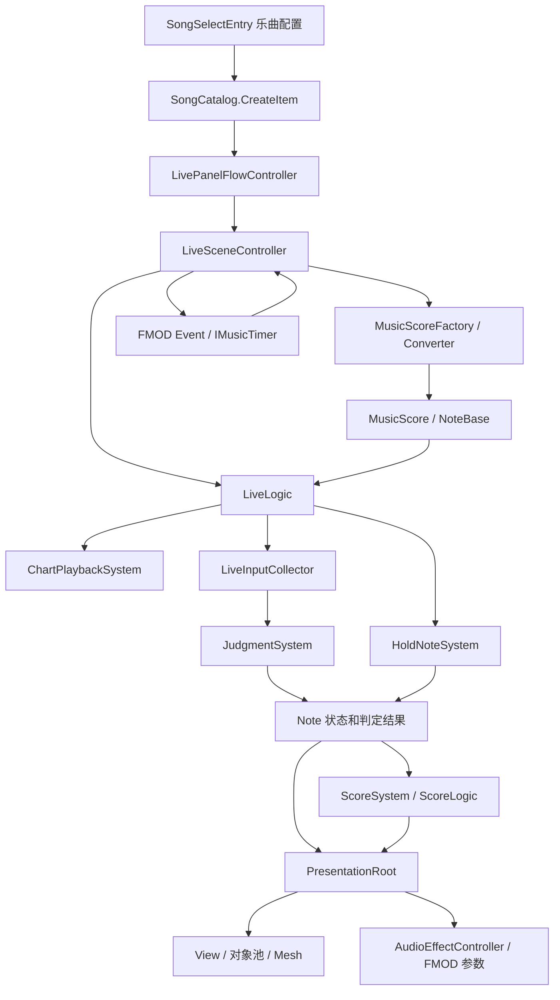
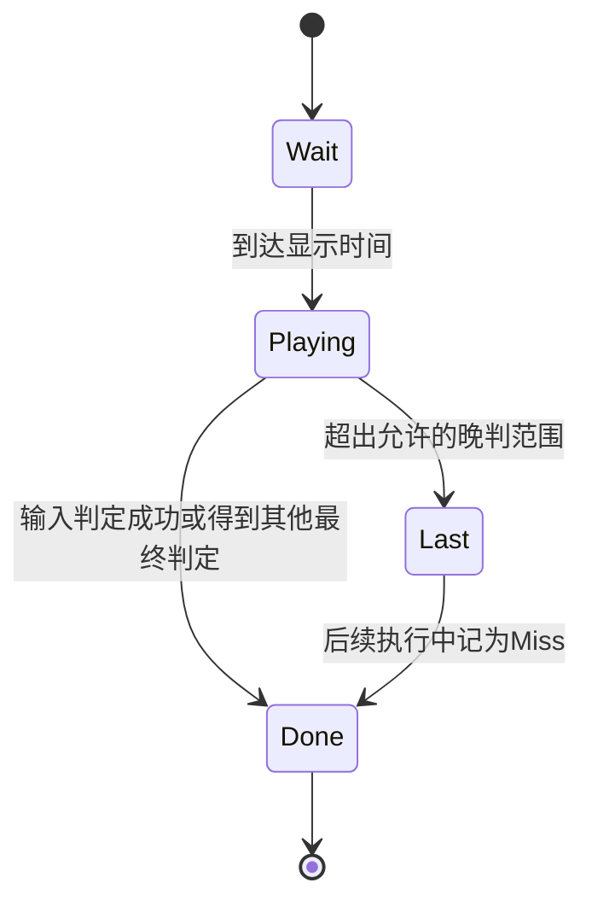

# 从谱面到判定：当前工程的代码导读

本文按当前 `TestFramework` 的静态实现讲解。链接从本目录指向工程文件；打开文件后搜索文中方法名即可定位。**“代码已见”不表示已做运行验证，也不表示该代码由你原创。**

## 1. 先建立四个概念

**谱面数据**回答“什么时候、在哪、需要怎样操作”。**运行状态**回答“这颗音符出现了没有、是否按住、是否已判定”。**输入**回答“玩家做了什么”。**显示和声音**把状态反馈给玩家。

同一个逻辑 Note 可以被对象池中的不同 GameObject 显示。反过来，一个显示 GameObject 在一首歌里可以先后显示很多逻辑 Note。不要把 `NoteBase` 和屏幕上的 Prefab 当成同一个对象。

另一个容易混淆的词是“分数”：`MusicScore` 在这里主要指**乐谱/谱面**，`ScoreLogic` 才负责成绩计算。

## 2. 当前入口与整体地图

【配置已见】Build Settings 启用 `xxAxxLive.unity`。场景直接绑定的是 `SoloLiveController`；[SoloLiveController.cs](../../Assets/Scripts/FFrameWork/Live/Core/SoloLiveController.cs) 是继承 [LiveSceneController.cs](../../Assets/Scripts/FFrameWork/Live/Core/LiveSceneController.cs) 的空包装，用于兼容原来的场景引用。

场景中 `startOnAwake = 0`、`musicStartOnAwake = 0`、`liveStartWaitTime = 0`。因此不能直接照源码默认值，把实际流程描述成“Awake 自动开始，固定等待六秒”。



`LiveLogic` 是演奏规则的协调者，而不是引擎。把类拆成几个文件有助于阅读，但仍需检查依赖方向和生命周期；文件数量不能证明架构好坏。

## 3. 从选曲到进入演奏

### 3.1 乐曲配置是什么

[SongSelectEntry.cs](../../Assets/Scripts/FFrameWork/Live/Data/SongSelectEntry.cs) 继承 `ScriptableObject`，保存一首歌某个难度的配置：ID、标题、封面、谱面 TextAsset、FMOD EventReference、难度、开始前等待时间、初始判定框宽度等。

它是 Unity 资产数据，不需要挂到某个场景 GameObject 上才能存在。

[SongSelectMenuController.cs](../../Assets/Scripts/FFrameWork/UI/SongSelectMenuController.cs) 按歌曲和难度组织菜单；[LivePanelFlowController.cs](../../Assets/Scripts/FFrameWork/UI/LivePanelFlowController.cs) 负责标题、操作说明、选曲、演奏和结果等页面流转。

### 3.2 配置怎样传给演奏

搜索 `LivePanelFlowController.StartLiveForSelectedSong`：

```text
selectedSong
  → SongCatalog.CreateItem(selectedSong)
  → liveController.ApplySong(...)
  → ResetLive()
  → SetupForManualStart()
  → StartLive()
```

[SongCatalog.cs](../../Assets/Scripts/FFrameWork/Live/Data/SongCatalog.cs) 把资产中的配置转换为运行时 `SongCatalogItem`。`ApplySong` 更新控制器里的音乐、谱面及设置，并清掉旧的 BootData，使后续初始化使用新乐曲。

`SetupForManualStart` 暂时关闭自动开始，完成初始化再恢复设置，随后外部明确调用 `StartLive`。这样页面切换和演奏起动不会互相抢着启动。

[LiveBootFactory.cs](../../Assets/Scripts/FFrameWork/Live/Data/LiveBootFactory.cs) 构建运行用 BootData，并带入玩家设置；这里的 Factory 可以理解为“集中组装一份启动数据的方法”。

### 3.3 SetupLiveLogic 做了什么

在 `LiveSceneController.SetupLiveLogic` 中依次看到：

1. 取得谱面字符串，用 `MusicScoreFactory.Create` 解析。
2. 解除旧 LiveLogic 的订阅和资源。
3. 准备共享 `InputManager`，传给箭头控制器和新 LiveLogic。
4. `new LiveLogic(liveBundleBuildData)`，执行 `Setup`。
5. 设置箭头和音效控制器。
6. 订阅 `OnFinished`、`OnFailure`。

注意“依赖共享”：一个场景级 InputManager 由场景拥有，使用它的对象不应各自 Dispose 同一份资源。`ownsInputManager` 就在区分“自己创建、负责销毁”和“外部传入、只使用”。

## 4. 谱面文件从哪里读

【代码已见】`SongSelectEntry.GetSusScoreText`：

```text
启用外部谱面？
  是 → Application.streamingAssetsPath + 相对路径
       → File.Exists / File.ReadAllText(UTF8)
       → 成功则返回文件内容
  未启用或读取失败 → 回退到 susScore.text
```

它还会从谱面中读取 `PLAYLEVEL`，解析 NoteList 来统计判定音符数量，并缓存统计结果。因此菜单显示不一定只用 Inspector 上手填的数值。

[SongSelectStreamingAssetsBuilder.cs](../../Assets/Scripts/FFrameWork/Editor/SongSelectStreamingAssetsBuilder.cs) 是编辑器工具：实现 `IPreprocessBuildWithReport`，在构建前查找所有 `SongSelectEntry`，把 TextAsset 写入 `Assets/StreamingAssets/Charts/...`，同时修改相应资产的加载配置。它也提供手动菜单。

这里有三个实际含义：

- 编辑用的 `Assets/Charts` 与运行读取的 `StreamingAssets/Charts` 可能不是同一份最新文本，调谱时要先确认真实入口。
- 构建辅助工具会写入/覆盖导出的谱面并修改资产，不是纯读取工具。
- 这是本地文件分发流程，不等于实现了远程资源更新或 Addressables。

Android/Web 上的 StreamingAssets 不能直接按普通文件路径读取，需要相应的访问方式；当前 `File.ReadAllText` 路径需要适配，回退 TextAsset 也可能掩盖外部读取失败。[Unity StreamingAssets 文档](https://docs.unity3d.com/6000.0/Documentation/Manual/StreamingAssets.html)

## 5. SUS 解析：把文本编译成运行对象

### 5.1 入口的实际顺序

打开 [MusicScoreFactory.cs](../../Assets/Scripts/FFrameWork/MusicScore/MusicScoreFactory.cs) 和 [Converter.cs](../../Assets/Scripts/FFrameWork/MusicScore/SUS/Converter.cs)，搜索 `Convert`：

```text
Initialize
  → Load：逐行读取，区分头部与事件/音符
  → ConvertMusicEventList：构建 BPM、拍数、速度、音量的时间信息
  → ConvertMusicScoreNoteList：中间 NoteInfo 变为具体 NoteBase 子类
  → AddNoteArray
  → SortMusicEventList / AddEventArray
```

`Initialize` 重建临时字典与列表，避免上一份谱面的数据留到下一次转换。Factory 会把构建配置和各类长按的内部计数密度交给 Converter。

注意：解析器生成了 `EventArray`，不表示主循环已经执行它的所有事件；当前 `ScoreSystem` 初始化时传入的是 `Array.Empty<EventBase>()`。应当按实际调用检查每种事件是否有消费者。

### 5.2 为什么不直接读一行就生成完整音符

音符的秒数依赖 BPM 与拍数；长按终点依赖前面出现的同 ID 起点；同一位置还可能有不同类型的信息。

所以先得到中间结构，再统一转换比较容易处理这些依赖。当前 `noteInfoDict`、`guideInfoDict` 按谱面位置及分层键保存信息，之后排序。**Dictionary 本身不是时间顺序的保证。**

`MusicScoreInfo` 保存小节、进度、秒数、BPM、拍数、速度倍率和 SE 音量等；`NoteBase` 及其子类保存运行时状态与行为。

### 5.3 用真实的一行算一遍

示例来自 [Assets/Charts/Trance1/Easy.txt](../../Assets/Charts/Trance1/Easy.txt)。这说明该源文件内容；实际播放若优先读取另一份文件，要再核对对应文本。

```text
#00002: 4
#BPM01: 142
#00008: 01
#002.fixed.tap.k4: 000000n200000000
```

按当前 Converter 的可读语法：

| 片段 | 意义 |
| --- | --- |
| `002` | 小节索引 2，索引从 0 开始 |
| `fixed` | 固定轨音符族 |
| `tap` | Tap 形态 |
| `k4` | 第 4 个固定键位置；不是逻辑轨道索引 4 |
| `00 00 00 n2 00 00 00 00` | 8 个等分槽，索引 3 上有一个宽度 2 的 Tap |

`CreateReadableNoteBarData` 每两个字符拆一个 token，`00` 跳过，`barProgress = i / values.Length`。因此进度为 `3/8 = 0.375`。

`TryGetReadableLane` 把 `k4` 转成四键索引 3，再用 `FourKeyLaneStarts = {4,6,8,10}` 得到内部起始轨道 10。宽度 2 的右端是 `10 + 2 - 1 = 11`，所以逻辑范围为 `[10,11]`。

这一段 BPM 恒为 142，每小节 4 拍：

```text
每拍秒数 = 60 / 142
每小节秒数 = 4 × 60 / 142 ≈ 1.690141
音符时间 = (2 + 3/8) × 4 × 60 / 142 ≈ 4.014085 秒
```

`n2` 的 2 是轨道宽度，不是 2 秒，也不是按两次。数据段等分数决定节奏精度，宽度决定横向范围。

### 5.4 BPM 变化怎么办

不能对整首歌始终使用 `(总拍数 × 60 / 最初BPM)`。

教学例子：0～4 拍 BPM120，4～8 拍 BPM180。第 8 拍的时间为：

```text
4 × 60/120 + 4 × 60/180 = 3.333333 秒
```

当前 `ConvertMusicEventList` 会把 BPM、拍数、速度和音量的变化排序，在变化点形成 `MusicScoreInfo`，使用前一段 BPM 与拍数累积到下一个变化点。`MusicScore.GenerateNoteMusicScoreInfo` 再选取该音符所属的时间段计算目标时间。

在这份代码中 `timeSignature` 主要作为“每小节拍数”参与计算，不应未经验证就宣称完整支持任意拍号分母和所有 SUS 变体。

### 5.5 ticks_per_beat 与扩展语法

`ticksPerBeat` 默认 480，部分速度/音量事件将 tick 偏移换算为小节进度。可读音符数据段自身使用 token 数量等分小节，不是每个 token 固定等于一个 tick。

文件中出现 `fixed.tap.k4`、`slider.long.l7.a` 等写法，且 Converter 有专门的正则和处理函数。这是**当前实现支持的可读扩展语法**，不要直接称它为所有 SUS 解析器都必须支持的标准。

`l7` 这种可读轨道编号转换后为内部索引 6；`k1～k4` 则通过固定键映射转换，两者不能混用。

### 5.6 长按连接与计数

长按有 ID，例如 `.a`、`.b`。解析器用临时字典 `tmpLong` 连接同 ID 的点；不同族还会生成具体的开始、中继、结束类型。

`LongJoinCheck` 会在起点和后续连接点之间生成 `LongHoldCombo`，建立父子关系。内部这些计数点不一定对应谱面上可见的 Tap，但可能参与总 Combo 和分数。

`comboBeat` 在该循环中以小节进度划分计数点，不要只看变量名就断言它代表“每个四分音符固定加几次 Combo”；要结合实际拍数和配置验证。

应该准备的解析边界包括：空文本、缺 BPM、无效宽度、越界轨道、非法 token、缺长按起点/终点、复用 ID、同位置终止与重新开始、BPM 与拍数同时变化。**这是待验证清单，不是已经通过的测试报告。**

## 6. 时间系统：三条时间轴不要混

### 6.1 当前音乐时间来自哪里

[FmodSyncedUnityTimer.cs](../../Assets/Scripts/FFrameWork/MusicPlayer/FmodSyncedUnityTimer.cs) 的 `Execute(float unityTime)` 虽然接受 Unity 时间，但当前实现直接读取 FMOD 时间线，未使用该参数插值。

```text
EventInstance.getTimelinePosition(out int timelinePosition)
  → 保存毫秒数
  → LiveSceneController.GetCurrentMusicTime 转成秒
```

API 读到的是事件时间线位置，不是已经测量好的“玩家耳边声音到达时刻”。API 时间线也不能直接等同于采样级调度精度。[FMOD EventInstance 文档](https://www.fmod.com/docs/2.03/api/studio-api-eventinstance.html#studio_eventinstance_gettimelineposition)

另一个 [AudioSourceSyncedUnityTimer.cs](../../Assets/Scripts/FFrameWork/MusicPlayer/AudioSourceSyncedUnityTimer.cs) 会读取 `timeSamples` 等并做 Unity 时间插值，但当前主控制器的 `MusicReady/PlayMusic` 路径使用 FMOD。**存在一个类与运行中使用它是两回事。**

### 6.2 当前工程的时间换算

在 `LiveSceneController.Update` 中：

```text
liveTime = FMOD播放毫秒 / 1000 + musicTimelineOffset
adjustedTime = max(liveTime + TimingAdjustData × 0.016667, 0)
scoreInfoTime = adjustedTime - fillerSec
```

音乐未开始、尚无 musicTimer 时，`GetCurrentMusicTime` 回退到 `Time.time - liveTimelineStartUnityTime`。`BeginLiveTimeline` 记录这个起点；音乐开始前可能已运行谱面逻辑，使谱面时间先为负数。

当前 `musicTimelineOffset = max(fillerSec,0)`，音乐也被安排在这段等待后启动。在 filler 非负、音乐已启动、且不考虑 clamp 时：

```text
谱面时间 ≈ FMOD播放时间 + timingAdjust
```

因此 filler 是开场等待的组织参数，不能不看调用链就当成对 BGM 波形做任意正负偏移的校准工具。示例乐曲资产 `Song1 Easy.asset` 的 filler 为 2 秒：谱面 4.014085 秒的音符，大致对应 FMOD 4.014085 秒、演奏总时间轴 6.014085 秒，假设 timingAdjust 为 0。

### 6.3 正负号：Fast/Late 从哪里来

这里有两种相反符号：

| 量 | 定义 | 正数代表 |
| --- | --- | --- |
| `NoteBase.OffsetJudgeTime` | 当前谱面时间 − 音符目标时间 | 目标时间已经过去 |
| `LiveConfig` 计算判定时的 offset | 音符目标时间 − 输入时间 | 玩家按早了 |

例子：目标 5.000，输入 4.980，LiveConfig offset 为 `+0.020`，是 Fast；输入 5.030 则为 `-0.030`，是 Late。

**演示日志也要看符号**：`LogDebugJudgment` 用“当前时间 − 音符时间”，与 `LiveConfig` 的 offset 相反。

`TimingAdjustData` 为正会让判定使用的谱面时间变大。同一个实际按键会被看成更晚的输入；具体调节界面的正负体验仍需实际验证。

### 6.4 为什么不是固定步长越高就越准

当前演奏通过 `Update` 读取时间和输入。FixedUpdate 是固定时间步的回调，通常用于物理；它不是音频硬件的时钟。换到 FixedUpdate 还可能引入自己的采样间隔。[Unity FixedUpdate 文档](https://docs.unity3d.com/6000.0/Documentation/ScriptReference/MonoBehaviour.FixedUpdate.html)

Unity 的 `AudioSettings.dspTime` 是基于音频系统处理采样数的时间。若将来设计 DSP 方案，需要明确起播基准、暂停、跳转和时钟映射；当前项目不能只换一个属性名就视为改造完成。[Unity dspTime 文档](https://docs.unity3d.com/6000.0/Documentation/ScriptReference/AudioSettings-dspTime.html)

### 6.5 当前精度限制

`InputManager` 用 `WasPressedThisFrame/IsPressed` 轮询，然后把传入的当前谱面时间赋给 `LiveInput.musicTime`。这不是保存输入硬件事件发生的时间戳。

60 FPS 一帧约 16.67ms，120 FPS 约 8.33ms。即使音乐时间基准可靠，输入晚一帧才被处理仍可能造成误差。帧内多次按放也需要专门设计事件队列才能完整区分。

改进方向是记录设备事件时间、来源与相位，映射到统一歌曲时间后判定。Input System 提供 `CallbackContext.time`，但它不能不经换算直接与 FMOD 时间比较；暂停、切歌、seek 后要重建映射。[Input System CallbackContext 文档](https://docs.unity.cn/Packages/com.unity.inputsystem@1.19/api/UnityEngine.InputSystem.InputAction.CallbackContext.html)

## 7. 每一帧怎样执行

打开 [LiveLogic.cs](../../Assets/Scripts/FFrameWork/Live/Core/LiveLogic/LiveLogic.cs)：

```text
LiveSceneController.Update
  → 获取音乐时间与补正后的谱面时间
  → LiveLogic.OnUpdate
      → ChartPlaybackSystem.UpdateTime
      → 清空本帧候选音符列表
      → RefreshActiveHoldNotes：先刷新持续条件
      → ChartPlaybackSystem.UpdateNotes：推进 Note，收集候选
      → UpdateActiveHoldInputs：持续输入作用到长按
      → ReconcileTrackedAudioEffects：清理失效音效
      → 检查全部结束和 ClearGauge
  → OnInput 或 OnAutoInput
  → 各 LiveView.OnUpdate
```

这里展示的是当前方法内的调用顺序。`ArrowController.Update` 是另一个组件的回调，不能据此断言它一定在上面的哪一步之前执行。需要检查脚本执行顺序或由单一入口明确编排。

### ChartPlaybackSystem 的职责

[ChartPlaybackSystem.cs](../../Assets/Scripts/FFrameWork/Live/Core/LiveLogic/ChartPlaybackSystem.cs) 保存整首歌的 Note 数组、当前时间信息、`noteStartIndex` 和显示提前量。

- 通过 `MusicScore.Update` 查当前 BPM 等状态。
- 调用各 Note 的 `Excute`，推进状态与 Progress。
- 把可判定音符放入 `judgmentNoteList`。
- 开头连续 Done 的音符可推进 `noteStartIndex`，减少重复处理。

注意当前 `UpdateNotes` 遇到还未到显示时刻的未来 Note 使用的是 `continue`，不是 `break`。不能说它每帧只遍历“当前窗口内的几个音符”；未来尾部仍可能被扫描。

`CalcTimeOffset` 根据显示提前量、谱面速度与单音符速度计算提前出现时间。变速部分使用小节进度加权，跨 BPM/速度事件的视觉连续性应单独验证，不能套一个全局匀速公式来证明正确。

## 8. 输入如何变成可判定的数据

### 8.1 输入适配层

[InputManager.cs](../../Assets/Scripts/FFrameWork/Live/Input/InputManager.cs) 统一包装自动生成的 `xxAxxInput`，并提供 `FixedLaneInput`、`ArrowInput`、`FreeLaneInput`。

两个 Action Map：`InLive` 用于演奏，`OutLive` 用于演奏外选择。切换时禁用另一组，避免同一操作同时影响菜单和游戏。

`TryGetFixedLaneInput` 的阶段转换：

```text
本帧按下 → Began
当前按住 → Moved
本帧松开 → Ended
其余 → 没有输入
```

这里 `Moved` 对固定键可表示“持续按住”，并不一定真的发生空间移动。

### 8.2 统一 LiveInput 的好处

`LiveInput` 包含来源、ID、相位、谱面时间、轨道范围、世界位置和移动差分等。上层判定不需要到处调用 `Keyboard.current`。

这给将来接入新输入设备提供了适配位置，但不能由此宣称已经完成 HID、MIDI 或 Arduino 接入。

### 8.3 物理输入与逻辑候选不是一对一

[LiveInputCollector.cs](../../Assets/Scripts/FFrameWork/Live/Core/LiveLogic/LiveInputCollector.cs) 做两件事：

1. 固定四键映射到 4、6、8、10。
2. 自由输入、横向移动、宽度输入根据箭头判定框覆盖范围，在多条逻辑轨道生成候选输入。

判定框左右界为 `CurrentX ± CurrentSize`，这里 `CurrentSize` 扮演半宽。输入可以覆盖多个轨道，但它们来自同一次物理操作。

如果框覆盖轨道 6、7、8，按一次自由输入可能生成三份逻辑输入；后面必须控制消费，不能默认三颗音符全部被击中。

## 9. 判定：来源、范围、时间与冲突解决

打开 [JudgmentSystem.cs](../../Assets/Scripts/FFrameWork/Live/Core/LiveLogic/Judgment/JudgmentSystem.cs)，`Execute` 的六步是理解核心：

| 方法 | 白话解释 |
| --- | --- |
| `SortJudgmentNotesByTime` | 候选音符先按时间整理 |
| `AllocateInputJudgableEachNotes` | 对每份输入检查能否操作这类音符，再检查范围、时机、阶段 |
| `OverlapJudgmentSorting` | 多份输入竞争同一音符时，根据位置距离移除冲突候选 |
| `LeaveNotesFastGeneration` | 一份逻辑输入有多个候选时，比较优先级 |
| `LeavePhysicalInputCandidates` | 多轨候选来自同一物理操作时，再选一份最终候选 |
| `EvaluateJudgment` | 调用具体 Note.Judgment，之后清理本帧列表 |

### 9.1 来源过滤很重要

`CanJudgeByInputSource` 中：

- FixedLane 只处理固定普通/长按类。
- Arrow 对应 SliderFlick。
- ArrowVolume 对应 VolumeFlick。
- FreeLane 用于其他自由轨类。
- SliderLong、VolumeFlickLong 不走这条普通候选路径，由持续系统处理。

所以“同一轨道附近有 Note”远远不够，还要输入类型匹配。

### 9.2 优先级不是一句“谁时间最近”

`CompareCandidatePriority` 依次比较：

1. 经长按子节点选择后的 `Progress`。
2. 横向轨道距离。
3. 更早的谱面时间。
4. 更小的 ID。

`SelectLeaveComparableNote` 对长按会按当前输入阶段选择开始或末端作为比较对象。应按代码说明，不能把算法讲成通用的“绝对时间差最小”。

### 9.3 同一物理输入怎样去重

`GetPhysicalInputKey` 结合输入来源与 ID。四键可以区分不同键；FreeLane/Arrow/ArrowVolume 则各自按来源合并其跨轨候选。

目的：一次物理操作不要因为扩展成多个逻辑轨道就重复得分。当前规则同时也限制了同来源输入能怎样处理重叠音符，是否符合和弦与宽音符玩法，需要拿实际谱面确认。

它不是通用多点触屏分配器。手机上同来源的多个手指必须保留独立身份，再设计分配规则。

### 9.4 NormalNote 怎样真正给出成绩

[NormalNote.cs](../../Assets/Scripts/FFrameWork/Live/Note/NormalNote.cs)：

```text
IsJudgment
  → 尚未 Done
  → lane 落入 JudgeLaneStart / JudgeLaneEnd
  → 输入时间处于该类型的判定范围
  → phase == Began

Judgment
  → LiveConfig.CalculateDefaultNoteResult
  → 可选的 onUpdateResult 补正
  → JudgeInfo = 结果
  → State = Done
```

这也解释为什么一直按住键不应自动击中所有后来的 Tap：它要求新一次 `Began`。

### 9.5 当前普通 Tap 的默认窗口

[LiveConfig.cs](../../Assets/Scripts/FFrameWork/Live/Core/LiveConfig.cs) 与 [MasterFixedLaneJudgeFrame.cs](../../Assets/Scripts/FFrameWork/Live/Core/LiveLogic/Judgment/MasterFixedLaneJudgeFrame.cs)：默认普通 Tap 的阈值按固定 `1/60` 秒换算。

| 等级 | 单侧默认范围约值 | 说明 |
| --- | --- | --- |
| JustPerfect | 8.3335ms | 先检查这一档 |
| Perfect | 41.667ms | 2.5 × 1/60 秒 |
| Great | 108.333ms | 6.5 × 1/60 秒 |
| Good | 150ms | 9 × 1/60 秒 |
| Bad | 200ms | 12 × 1/60 秒 |
| Miss | 超出有效窗口后 | 不必有按键，Note 过期也会结束 |

这是代码里的默认普通 Tap 规则，其他 Note 类型可能不同，运行时字典也可能被调整。`LiveConfig` 顶部另有一些基准常量，不能跳过实际 frame 表而直接拿它们报窗口值。

表里窗口是包含式边界，计算依次检查较好等级，所以下一档实际上接住上一档之外的剩余范围。120 FPS 不会使 `1/60` 自动变成 `1/120`。

### 9.6 Flick 并非方向错就立刻 Miss

当前方向类计算函数 `GetPerfectOrMissJudgeResult` 在方向不符或尚不合时返回 `None`，可能继续等待；方向正确且进入相应窗口则返回 Perfect。之后何时超时、是否完成，由具体 Note 状态逻辑控制。

## 10. Note 状态与最终回调

[NoteBase.cs](../../Assets/Scripts/FFrameWork/Live/Note/NoteBase.cs) 不是 MonoBehaviour；由外部显式调用执行。

普通 Tap 可按下图理解，长按会增加自己的状态分支：



`State` 的 setter 在进入 Playing 时通知 Spawn，在进入 Done 时通知 Unspawn。`OnUnSpawnNote` 内部顺序是：

```text
onJudgment → onUpdateCombo → onUpdateScore → onDamage → onUnspawn
```

在当前组装关系里，这些回调连向计分、音效追踪和显示解除。不是每个 Note 在自己类里直接搜索 UI。

有一个需要注意的维护点：setter 本身没有统一的“重复设置相同状态就退出”保护，多数调用方靠 Done 检查避免重复结束。未来改状态逻辑时，要确认不会重复计分。

## 11. 长按为什么需要专门系统

普通 Tap 主要关心一次 `Began`。长按还要关心：开始是否有效、此刻是否仍保持、途中断开是否容错、中继点如何处理、末端要不要松手/滑动，以及何时停止音效。

相关文件：

- [LongNote.cs](../../Assets/Scripts/FFrameWork/Live/Note/LongNote.cs)：共有长按状态、子节点和输入持续逻辑。
- [FreeLaneLongNote.cs](../../Assets/Scripts/FFrameWork/Live/Note/FreeLaneLongNote.cs)：自由输入按住情况与判定框范围。
- [SliderLongNote.cs](../../Assets/Scripts/FFrameWork/Live/Note/SliderLongNote.cs)：箭头位置覆盖与持续状态。
- [VolumeLongNote.cs](../../Assets/Scripts/FFrameWork/Live/Note/VolumeLongNote.cs)：宽度变化方向、持续输入和目标宽度进度。
- [HoldNoteSystem.cs](../../Assets/Scripts/FFrameWork/Live/Core/LiveLogic/HoldNoteSystem.cs)：协调这些 Note 和音效生命周期。

`IsHoldInputActive` 由某些输入状态推导；`IsHoldJudgmentActive` 是当前持续条件是否有效。两者语义不同，不能都翻译成“按着”。

`HoldNoteSystem` 先刷新已开始长按的有效性，再推进 Note，再尝试更新当前长按，最后检查追踪音效是否应停止。这个顺序会影响中间计数点读取的是当前有效状态还是旧状态，修改前要画出调用顺序。

当前还有两种不同的容错：

- 部分 LongNote 使用 `lastInputFrame + MissMesh < Time.frameCount`，阈值基于真实渲染帧计数。
- VolumeLongNote 有 `ArrowVolumeHoldGraceSeconds = 0.5f`，以时间为单位保留部分有效输入。

所以虽然普通 Tap 判定窗口用固定秒数，**长按部分仍存在随实际 FPS 改变容错时长的可能**。这只是静态读到的设计差异，是否造成玩家可见问题需要对照验证。

Auto 模式与手动路径也并非完全相同；Auto 能跑完整首歌，不证明人工输入的长按状态都正确。

## 12. 箭头位置与宽度变化

[ArrowController.cs](../../Assets/Scripts/FFrameWork/Live/Arrow/ArrowController.cs) 读取鼠标横向差分，经过灵敏度换算交给 [ArrowLogic.cs](../../Assets/Scripts/FFrameWork/Live/Arrow/ArrowLogic.cs)。后者保存 `ArrowJudgmentFrame` 并 Clamp 位置范围，再由 View 显示。

中心灵敏度代码可化为：

```text
t = clamp01(abs(x) / centerZoneThreshold)
multiplier = lerp(centerSensitivityMultiplier, 1, t)
deltaX = rawMouseDeltaX × sensitivity × multiplier
```

【配置已见】`xxAxxLive.unity` 中 sensitivity 为 1.2、中心阈值为 180、中心倍率为 1.5。所以在中心 x=0 时倍率约为 `1.2 × 1.5 = 1.8`，到阈值处约为 1.2。**这个场景配置是中央增敏，而注释写的是衰减。**

这不自动说明哪一种行为符合设计；实际动机要你确认，也可能被运行时修改。它说明面试解释必须同时看代码和 Inspector。

鼠标 delta 是事件积累的位移差分，不是“单位时间速度”。不能不加分析地再乘 `deltaTime`。

`ArrowLogic` 定义 9 个宽度阶段，VolumeFlick 成功后由回调设置目标阶段，VolumeLong 则记录开始/目标尺寸，按进度插值，结束时成功落到目标、失败选择中途回退阶段。

虽然 Action 里有鼠标 Y 的 size delta，`ArrowLogic.OnUpdate` 的兼容参数本身不直接自由缩放尺寸。宽度玩法与音符判定结果/长按进度相连，不能说“鼠标 Y 原样就是框宽”。

## 13. 计分、Combo 与 ClearGauge

[ScoreSystem.cs](../../Assets/Scripts/FFrameWork/Live/Core/LiveLogic/ScoreSystem.cs) 负责组装/订阅与转发；[ScoreLogic.cs](../../Assets/Scripts/FFrameWork/Live/Core/LiveLogic/ScoreLogic.cs) 保存成绩状态并计算。

初始化会枚举根 Note 的 `NoteList` 中 `HasJudgment` 的节点，计算总 Combo。它不一定等于根 Note 数量，也不是直接数谱面文本行数。

### 13.1 分数公式

当前逻辑可写成：

```text
BaseNoteScore = 设定满分 / max(1, 总计分节点数)
Normalization = 总计分节点数 / max(1, 全部权重和)
本次加分 = BaseNoteScore × 判定倍率 × 节点权重 × Normalization × 退出衰减
```

默认满分后备值为 1,000,000；默认 JustPerfect/Perfect/Auto 倍率 1，Great 0.7，Good 0.5，Bad/Miss 为 0。当前 `GetNoteScoreFactor` 返回统一默认权重，不应声称各音符已经有复杂的差异化权重。

内部累加 float，显示再取整和吸收接近满分时的小误差。每次直接加取整后的数值可能造成累计丢分，这是保存内部累积值的原因之一。

### 13.2 Combo 与通关不是同一个条件

`UpdateCombo` 中 Great 及以上保留并增加 Combo，低于 Great 会清零。Good 可以有分数/量规收益，但仍断 Combo。

默认 ClearGauge 范围 0～100，通关阈值 70；JustPerfect/Perfect 默认 +2，Great/Good +1，Bad -3，Miss -5，最终受配置和 Clamp 限制。

在 `LiveLogic` 中，全部音符结束后按 `IsClearGauge` 决定 Clear 或 Failure。最终场景结果还有额外转换，详见下方疑点，不能直接声称整个结果链已验证无误。

还有一处需核对：BootFactory 的预览 rank 阈值可能按“音符数 × 1000”生成，而 ScoreLogic 满分来源是另一个配置。应确认所有难度的评级阈值与满分使用相同尺度。

## 14. 显示、对象池、长条 Mesh 与 Shader

### 14.1 显示进度不是判定依据

`NoteBase.CalcProgress`：

```text
progress = (当前谱面时间 + 显示提前秒数 - 目标时间) / 显示提前秒数
```

提前量 2 秒、目标 10 秒时：当前 8 秒为 0，9 秒为 0.5，10 秒为 1。它用于显示，不改变目标时间。

[BaseNoteView.cs](../../Assets/Scripts/FFrameWork/Live/Views/BaseNoteView.cs) 读取 Progress，限制显示范围，再计算位置。普通 Note 的位置路径使用 `LiveUtility.EarlyVec2Lerp`，其实现为 `a + (b-a) × max(t,0)`；在提前量固定且进度处于 0～1 时，这一位置插值是线性的。变速和长条显示还要分别看提前量、子节点与 Mesh 的实现，不能只凭这一个公式说明所有视觉行为。

### 14.2 对象池怎样串起来

```text
Note.State = Playing
  → LiveLogic.OnSpawnNote
  → PresentationRoot / LiveViewPresenter
  → LiveFrontView / NotesViewManager
  → 对应类别 NotePool.Spawn

Note.State = Done
  → 对应的 Unspawn 链路
  → 关闭显示，供以后复用
```

[NotePool.cs](../../Assets/Scripts/FFrameWork/Live/Core/LiveLogic/NotePool.cs) 预生成对象并轮换使用，若取中的对象仍 active 会创建新实例。它不是绝对不会扩容的池；当前策略也不一定在扩容前搜索所有空闲项。

[LiveViewPresenter.cs](../../Assets/Scripts/FFrameWork/Live/Core/LiveLogic/LiveViewPresenter.cs) 根据谱面估计同时显示数量，供预热使用。速度变化、长条重叠和真实窗口是否导致估计不足，需要密集谱验证。

[NotesViewManager.cs](../../Assets/Scripts/FFrameWork/Live/Core/NotesViewManager.cs) 用 `Dictionary<INote,BaseNoteView>` 保存逻辑 Note 到显示对象的对应；它还按类别维护长条线。

### 14.3 长条怎样生成

[LongNoteMesh.cs](../../Assets/Scripts/FFrameWork/Live/Views/LongNoteMesh.cs) 保存顶点、UV、颜色和三角索引数组，把相邻分割点构成台形网格，再把状态数据交给 Shader。

这可以理解为“CPU 准备几何形状和每点数据，GPU 决定每个像素怎样着色”。动态 Mesh 经验与在 Blender/Maya 制作模型是不同的能力。

[FixedLongNoteLine.shader](../../Assets/Shader/FixedLongNoteLine.shader) 当前包括纹理采样、顶点色、透明度和判定闪光。`Blend SrcAlpha OneMinusSrcAlpha` 做常见透明混合，`ZWrite Off` 避免透明线写深度引发一些遮挡问题，但透明叠加仍会带来 overdraw 与排序要求。

不要据此宣称“手写整个渲染管线”或“已在手机优化完成”。

## 15. FMOD 音乐与效果的职责

音乐播放在 `LiveSceneController`：准备 sample data、CreateInstance、start、getTimelinePosition、setPaused、seek，最后 stop/release。

`EventReference` 指向一个事件定义，`EventInstance` 是它的一次运行实例，bank 是运行需要的构建数据。这些角色不要混称。

音效联动链：

```text
HoldNoteSystem
  → PresentationRoot / LiveEffectPresenter
  → AudioEffectController
  → AudioEffectParameterApplier
  → 优先修改当前音乐 EventInstance 参数
  → 失败时尝试 FmodAudioEffectSystem 的全局参数路径
```

代码中的效果类别映射包含 SliderLong 的 Wobble、FreeLaneLong 的 FlangerMix、VolumeLong 的低通/高通类别。能确认的是调用与参数控制结构；具体听感、滤波曲线和 FMOD Studio 路由要看音频源工程并实际试听。

`HoldNoteSystem` 追踪哪些长按开启了效果，处理正常结束、断开和 Dispose。这能避免效果状态永久残留，但多个同类长按同时争用一个参数时的规则仍需验证。

## 16. 暂停、重试和退出

`Pause` 保存时间，设置 isPaused，暂停音乐并通知各 View。`Update` 在暂停时跳过主要推进。并没有靠全局 `Time.timeScale = 0` 暂停所有内容。

`Resume` 有 Coroutine 倒计时；随后 seek 回保存的位置、继续音乐、刷新输入并通知 View。刷新临时输入列表，不等于已经解决操作系统和设备层所有残留按键问题。

`ResetLive` 停止相关协程、音乐与旧逻辑，清理状态并要求 View Retry。重新开始会再次解析谱面、创建新的逻辑 Note；显示对象池则有自己的重试生命周期。

退出中要关注三种所有权：托管逻辑对象、Unity 原生对象、FMOD 实例。C# GC 不会替你自动完成后两者所有显式资源释放工作。

## 17. 目前值得诚实讨论的疑点

以下是静态发现的验证目标，不是已复现的全部 Bug，也不是本轮已修复事项。

| 优先级 | 读到的事实 | 潜在影响 | 应怎样验证 |
| --- | --- | --- | --- |
| 高 | `LiveSceneController.PreExit` 将 `liveLogic.Result == Failure` 映射成 `LiveResult.Clear` | 低量规结束可能显示为通关；也可能是遗留策略 | 用全部 Miss、量规不足完成歌曲，对照逻辑结果、LastResult 与 UI；再确认预期 |
| 高 | 输入按当前帧时间赋值 | 精度受帧轮询影响 | 对照 30/60/120 FPS 的事件时刻与消费时刻，记录误差分布 |
| 高 | StreamingAssets 使用普通文件 API | Android 外部谱面读取不符合其路径模式 | 真机加载并记录来源，检查是否悄悄回退 |
| 中 | 长按同时存在帧计数和秒数容错 | 实际容错可能随 FPS 不一致 | 用同样长度的输入中断跨 FPS 对照 |
| 中 | ArrowController 与主控制器各有 Update | 判定可能读取到不同帧阶段的箭头状态 | 查执行顺序并记录同帧时间/框位置，确认后考虑统一编排 |
| 中 | 结果 rank 阈值与满分有不同来源 | 显示评级可能与完成度不匹配 | 对照不同长度谱面的满分、rank 阈值和结果 |
| 中 | `ScoreLogic.ApplyClearGauge` 有未加开发条件的 string.Format / Debug.Log；ViewPresenter 有捕获 Note 的 lambda | 演奏中可能有托管分配 | 用 Profiler 按调用栈测 GC.Alloc，不只凭语法判断 |
| 中 | `LiveConfig.EnsureJudgeFrames` 会枚举 enum 并检查配置 | 高频判定时存在可测的重复工作 | 用 CPU/GC 采样确认，再考虑初始化缓存 |
| 中 | NotePool 不足时 Instantiate；播放器扫描未来尾部 | 密集谱可能出现额外开销 | 统计池扩容、CPU 时间与最大同屏数 |
| 中 | `LongNoteMesh.Setup` 创建 Material 与 Mesh | 需要跟踪原生对象生命周期 | 多轮进出演奏比较对象和内存数量，检查清理路径 |
| 需设计确认 | 中心倍率场景为 1.5，默认 0.8，注释称衰减 | 解释或手感目标可能不一致 | 由本人说明设计，再验证当前配置 |

面试表达可以是：“我能指出这条分支和风险，并说明如何复现验证。”只有真正查明和完成修正后，才能说“我修复了这个问题”。

## 18. 一颗 Tap 的完整口头复述

> 选曲配置给出谱面文本和音乐事件。Factory 调用 Converter，先建立时间段，再生成有目标时间和轨道范围的 NormalNote。控制器读取 FMOD 时间线，转换成谱面时间，播放器推进 Note 的显示进度和状态。InputManager 把按键转换成带来源、相位和时间的 LiveInput。Collector 映射轨道，JudgmentSystem 过滤并解决多个候选的冲突。NormalNote 根据输入时间差计算成绩，进入 Done，触发 Combo、分数、量规和显示回收。可见 GameObject 来自对象池，与逻辑 Note 分开管理。

能不看这段说出流程之后，再练习说明：哪个环节出问题会造成“音符看着到了但按不到”“一次按键算两次”“长按声音不停止”。
